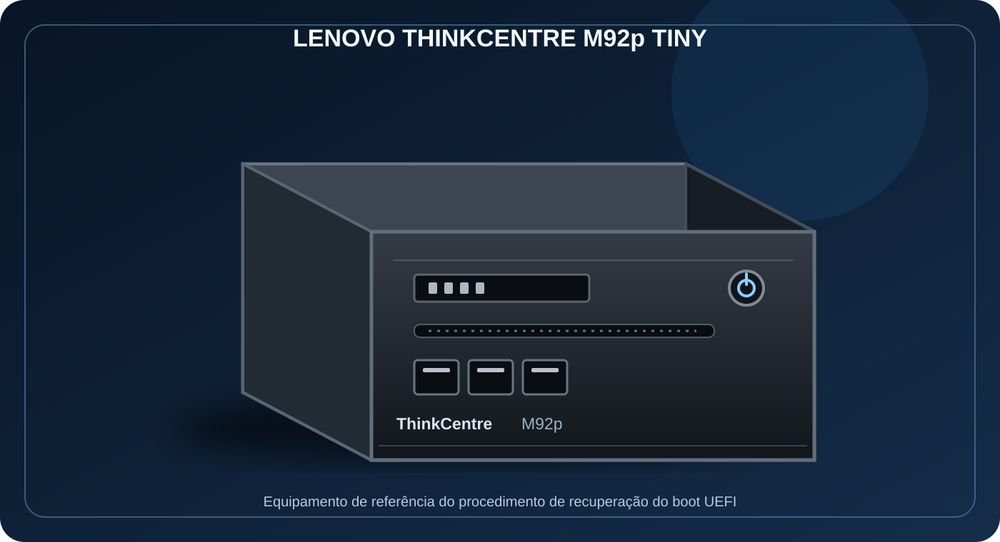
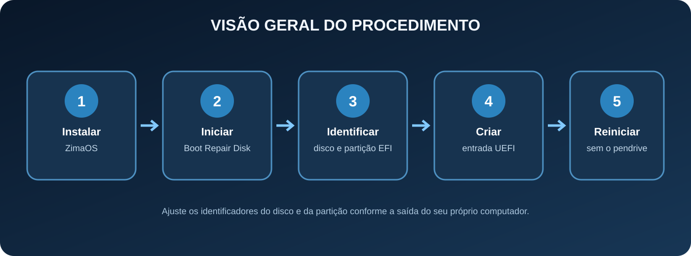

# Correção do erro 1962 no Lenovo ThinkCentre após instalar o ZimaOS



> **Equipamento em destaque:** Lenovo ThinkCentre M92p Tiny. Este é o mini PC usado como referência prática para documentar a recuperação da inicialização UEFI após a instalação do ZimaOS.

[](https://www.zimaspace.com/)
[](https://www.lenovo.com/)
[](#)

Este repositório documenta uma solução para o **erro 1962**, que pode aparecer no primeiro boot após instalar o ZimaOS em determinados mini PCs Lenovo ThinkCentre. O procedimento consiste em iniciar um ambiente de reparo, identificar a partição EFI e registrar manualmente uma entrada de inicialização UEFI para o carregador do ZimaOS.

O guia foi organizado para facilitar a reprodução do procedimento, com comandos, alertas e ilustrações. Os nomes de discos e partições apresentados são exemplos: cada equipamento deve ser conferido individualmente.

## Índice

- [Equipamento de referência](#equipamento-de-referência)
- [Visão geral do procedimento](#visão-geral-do-procedimento)
- [Pré-requisitos](#pré-requisitos)
- [Tutorial passo a passo](#tutorial-passo-a-passo)
- [Verificação e solução de problemas](#verificação-e-solução-de-problemas)
- [Projetos relacionados](#projetos-relacionados)

## Equipamento de referência


O **Lenovo ThinkCentre M92p Tiny** é o equipamento de referência desta documentação. A ilustração acima destaca o formato compacto da linha Tiny e identifica o modelo utilizado no projeto.

O procedimento também pode ser útil em outros Lenovo ThinkCentre, incluindo M70q, M73, M75, M80q, M90q, M720, M920 e variantes Tiny. Isso não representa garantia de compatibilidade: o comportamento pode variar conforme BIOS/UEFI, versão do firmware, disco e estrutura da partição EFI.

## Visão geral do procedimento



Em resumo: instalar o ZimaOS, iniciar o Boot Repair Disk, localizar a partição EFI, criar a entrada UEFI e reiniciar o computador sem o pendrive.

## Pré-requisitos

- Lenovo ThinkCentre com ZimaOS instalado.
- Pendrive inicializável com o **Boot Repair Disk**.
- Teclado e monitor conectados ao equipamento.
- Acesso ao terminal do ambiente de reparo.
- Conhecimento de qual disco contém a instalação do ZimaOS.

### Links oficiais e downloads

- [Documentação oficial do ZimaOS — instalação](https://www.zimaspace.com/docs/pt-PT/zimaos/how-to-install-zimaos)
- [Boot Repair Disk — SourceForge](https://sourceforge.net/projects/boot-repair-cd/)

## Tutorial passo a passo

### 1. Instale o ZimaOS

Faça a instalação seguindo a [documentação oficial do ZimaOS](https://www.zimaspace.com/docs/pt-PT/zimaos/how-to-install-zimaos).

Conclua a instalação e reinicie o computador. No cenário documentado, o equipamento apresenta o **erro 1962** e não inicia o sistema pelo disco.

### 2. Prepare o Boot Repair Disk

1. Baixe a imagem do [Boot Repair Disk](https://sourceforge.net/projects/boot-repair-cd/).
2. Grave a imagem em um pendrive inicializável, utilizando uma ferramenta de gravação de imagens.
3. Conecte o pendrive ao ThinkCentre.
4. Ligue o equipamento e selecione o pendrive no menu de inicialização.

Aguarde o carregamento do ambiente de reparo.

### 3. Abra o terminal e identifique o disco

No Boot Repair Disk, abra o terminal e execute:

```bash
sudo fdisk -l
```

Identifique o disco onde o ZimaOS foi instalado e localize a partição EFI correspondente. Confira o tamanho, o tipo e as partições exibidas.

> **Atenção:** os comandos seguintes usam `/dev/sda` como exemplo de disco e `/dev/sda1` como exemplo de partição EFI. Seu equipamento pode utilizar identificadores diferentes, como `/dev/nvme0n1` e `/dev/nvme0n1p1`. Não copie os exemplos sem conferir a saída do comando.

### 4. Monte a partição EFI

Crie o ponto de montagem:

```bash
sudo mkdir -p /mnt/efi
```

Monte a partição EFI identificada. No exemplo deste tutorial:

```bash
sudo mount /dev/sda1 /mnt/efi
```

Se a montagem apresentar erro, pare e confirme se a partição selecionada é realmente a EFI.

### 5. Consulte as entradas UEFI existentes

Execute:

```bash
sudo efibootmgr -v
```

O comando lista as entradas de inicialização UEFI, os identificadores e os caminhos dos carregadores. Confira as entradas existentes antes de criar uma nova.

### 6. Registre a entrada do ZimaOS

Com o disco e a partição EFI corretamente identificados, execute o comando abaixo adaptando os parâmetros ao seu equipamento:

```bash
sudo efibootmgr -c -d /dev/sda -p 1 -L "ZimaOS" -l '\\EFI\\BOOT\\bootx64.efi'
```

Neste exemplo:

- `-c`: cria uma nova entrada de inicialização.
- `-d /dev/sda`: indica o disco que contém a partição EFI.
- `-p 1`: indica o número da partição EFI nesse disco.
- `-L "ZimaOS"`: define o nome exibido no menu UEFI.
- `-l`: informa o caminho do carregador EFI.

O caminho `\\EFI\\BOOT\\bootx64.efi` deve existir na partição EFI utilizada. Se o arquivo estiver em outro caminho, o comando deverá ser ajustado.

### 7. Verifique a entrada e a ordem de inicialização

Execute:

```bash
sudo efibootmgr
```

Procure a entrada criada, que poderá aparecer em formato semelhante a:

```text
Boot0000* ZimaOS
```

O identificador numérico pode ser diferente. O asterisco indica que a entrada está ativa.

Confira também a linha `BootOrder`. Para iniciar diretamente pelo ZimaOS, o identificador correspondente deve estar na primeira posição. A existência da entrada, isoladamente, não garante que ela seja a primeira opção de boot.

**Não utilize números de exemplo para alterar a ordem.** Caso seja necessário ajustar o `BootOrder`, utilize somente os identificadores exibidos pelo próprio computador.

### 8. Reinicie o ThinkCentre

1. Encerre ou reinicie o ambiente de reparo.
2. Remova o pendrive do Boot Repair Disk.
3. Ligue novamente o Lenovo ThinkCentre.
4. Verifique se o ZimaOS inicia pelo disco interno.

## Verificação e solução de problemas

| Situação | O que conferir |
|---|---|
| O disco não aparece como `/dev/sda` | Identifique o nome real com `sudo fdisk -l`. |
| A montagem EFI falha | Confirme o número e o tipo da partição EFI. |
| A entrada não aparece | Execute novamente `sudo efibootmgr -v` e confira se o comando foi concluído sem erro. |
| A entrada existe, mas o erro continua | Confira o `BootOrder`, o modo UEFI e a existência do arquivo EFI indicado. |
| O firmware não inicia pelo ZimaOS | Verifique as configurações de boot da BIOS/UEFI e a compatibilidade do carregador. |

### Cuidados importantes

- Faça a identificação do disco com atenção antes de executar qualquer comando.
- Não formate, apague ou recrie partições durante este procedimento.
- Não presuma que a partição EFI será sempre `/dev/sda1`.
- Este guia documenta uma recuperação específica de inicialização UEFI; não substitui a documentação oficial do ZimaOS.
- A nomenclatura dos menus da BIOS/UEFI pode variar entre versões e modelos Lenovo.

## Projetos relacionados

Este procedimento faz parte do mesmo ambiente de servidor doméstico usado no desenvolvimento da **Central da Casa**, painel do Home Assistant executado sobre o ZimaOS.

- **Projeto deste tutorial:** [ZimaOS em mini PCs Lenovo ThinkCentre — correção do erro 1962](https://github.com/Douglas-TADS/ZimaOS-em-Mini-PC-Lenovo-ThinkCentre-M92P-M70q-M73-M75-M80q-M90q-M720-M920-Tiny-ETC)
- **Projeto complementar:** [Central da Casa — Dashboard Home Assistant](https://github.com/Douglas-TADS/Dashboard-Home-Assistant)

Consulte também o repositório da [Central da Casa](https://github.com/Douglas-TADS/Dashboard-Home-Assistant) para acompanhar a interface, os cartões, as integrações e o monitoramento do servidor.

---

<sub>Documentação comunitária mantida por Douglas-TADS. Ilustrações vetoriais produzidas para este repositório; não representam fotografias oficiais da Lenovo nem capturas reais do sistema.</sub>
