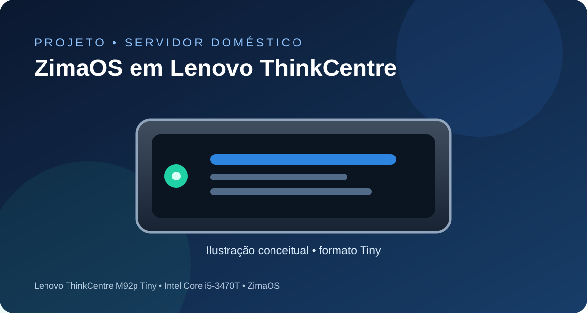
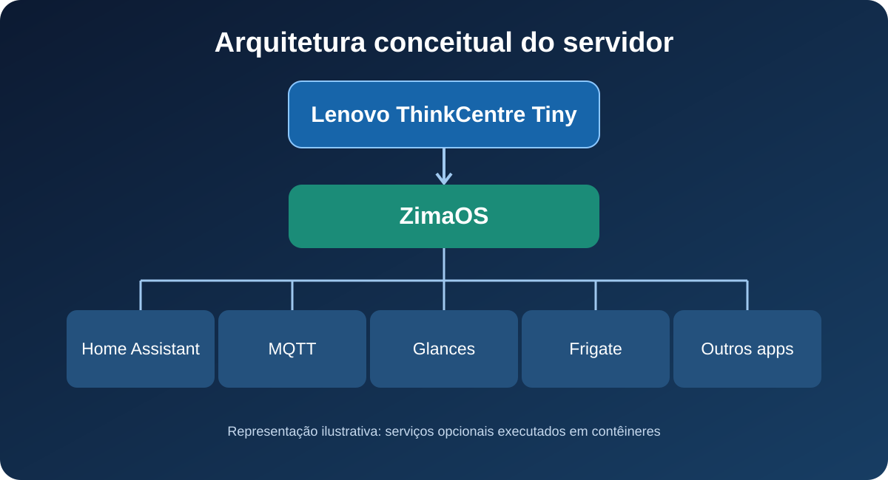

# ZimaOS em Mini PCs Lenovo ThinkCentre

> Guia comunitário de instalação, configuração inicial e utilização do **ZimaOS** em mini PCs Lenovo ThinkCentre. As imagens deste repositório são ilustrativas, não fotografias do equipamento nem capturas reais da interface.

## Sobre o projeto

Este repositório reúne orientações para transformar um mini PC Lenovo ThinkCentre em um servidor doméstico de baixo consumo utilizando o **ZimaOS**. A proposta é aproveitar equipamentos compactos que podem hospedar serviços, contêineres Docker, armazenamento e aplicações de automação residencial.

O equipamento de referência utilizado no projeto é um **Lenovo ThinkCentre M92p Tiny**, com processador Intel Core i5-3470T. O procedimento pode servir como referência para outros modelos ThinkCentre Tiny, mas a compatibilidade deve ser verificada individualmente: gerações diferentes podem apresentar opções distintas de BIOS/UEFI, controladoras, rede e armazenamento.

## Equipamento de referência

| Item | Configuração de referência |
|---|---|
| Fabricante / linha | Lenovo ThinkCentre Tiny |
| Modelo testado neste projeto | M92p Tiny |
| Processador | Intel Core i5-3470T |
| Memória e armazenamento | Variam conforme a configuração instalada |
| Sistema operacional | ZimaOS |
| Uso pretendido | Servidor doméstico e aplicações em contêineres |

**Importante:** a lista de modelos citada no nome do repositório indica o escopo de interesse da documentação, não uma certificação de que todos foram testados. Antes da instalação, confirme os requisitos e a compatibilidade do modelo específico.

## O que você encontrará aqui

- Preparação da mídia de instalação.
- Verificações de BIOS/UEFI e inicialização por USB.
- Instalação inicial do ZimaOS.
- Configuração de rede, armazenamento e acesso ao painel.
- Recomendações para instalar e administrar aplicações em contêineres.
- Diagnóstico inicial e cuidados para recuperação de inicialização.
- Relação entre o servidor ZimaOS e o projeto de automação residencial.

## Ilustração da arquitetura

O ZimaOS atua como base do servidor. Sobre ele podem ser executados serviços independentes em contêineres, como Home Assistant, MQTT, monitoramento e gerenciamento de mídia. A disponibilidade de cada serviço depende da configuração e dos recursos do equipamento.

## Tutorial

Consulte o passo a passo completo em **[TUTORIAL DE INSTALAÇÃO E CONFIGURAÇÃO](TUTORIAL_INSTALACAO.md)**.

## Projeto relacionado: Central da Casa

Este servidor também é a infraestrutura do projeto **Central da Casa**, um painel Lovelace para Home Assistant que reúne automação residencial, câmeras, conectividade e monitoramento do servidor.

➡️ **[Acessar o repositório da Dashboard Home Assistant — Central da Casa](https://github.com/Douglas-TADS/Dashboard-Home-Assistant)**

> O repositório da dashboard pode exigir autorização de acesso. A documentação deste projeto de ZimaOS é independente e pode ser consultada separadamente.

## Aviso e responsabilidade

Este material é uma documentação comunitária, produzida a partir de uma instalação de referência. Faça backup dos dados antes de alterar partições, firmware ou sistema operacional. Menus, opções e resultados podem variar de acordo com o modelo, versão de BIOS/UEFI, unidade de armazenamento e versão do ZimaOS.

Consulte também a documentação oficial: [ZimaOS](https://www.zimaspace.com/) e [Central de documentação Zima](https://www.zimaspace.com/docs).

## Contribuições

Sugestões, correções e relatos de compatibilidade são bem-vindos. Ao compartilhar resultados, informe o modelo exato do ThinkCentre, processador, memória, unidade de armazenamento, versão do BIOS/UEFI e versão do ZimaOS.

---

**Autor:** Douglas TADS  
**Idioma:** Português (Brasil)
